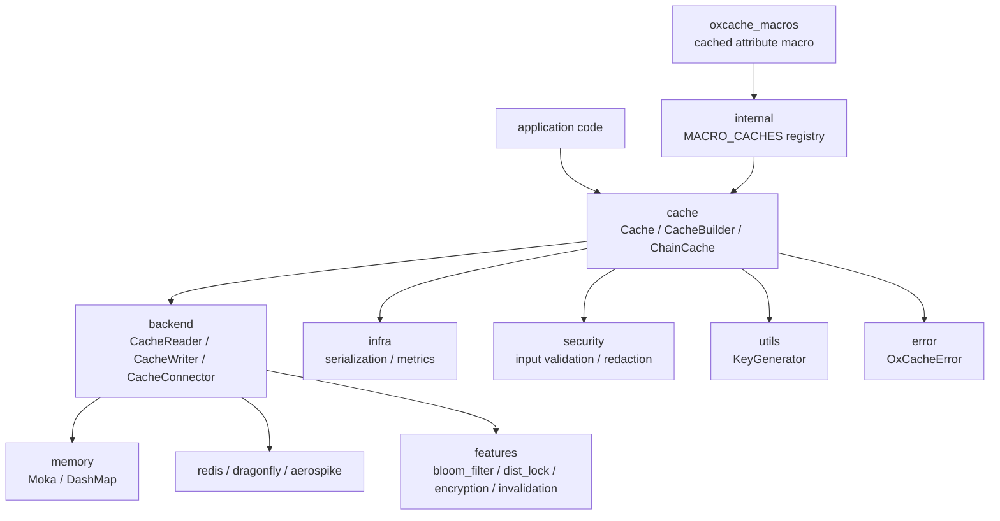
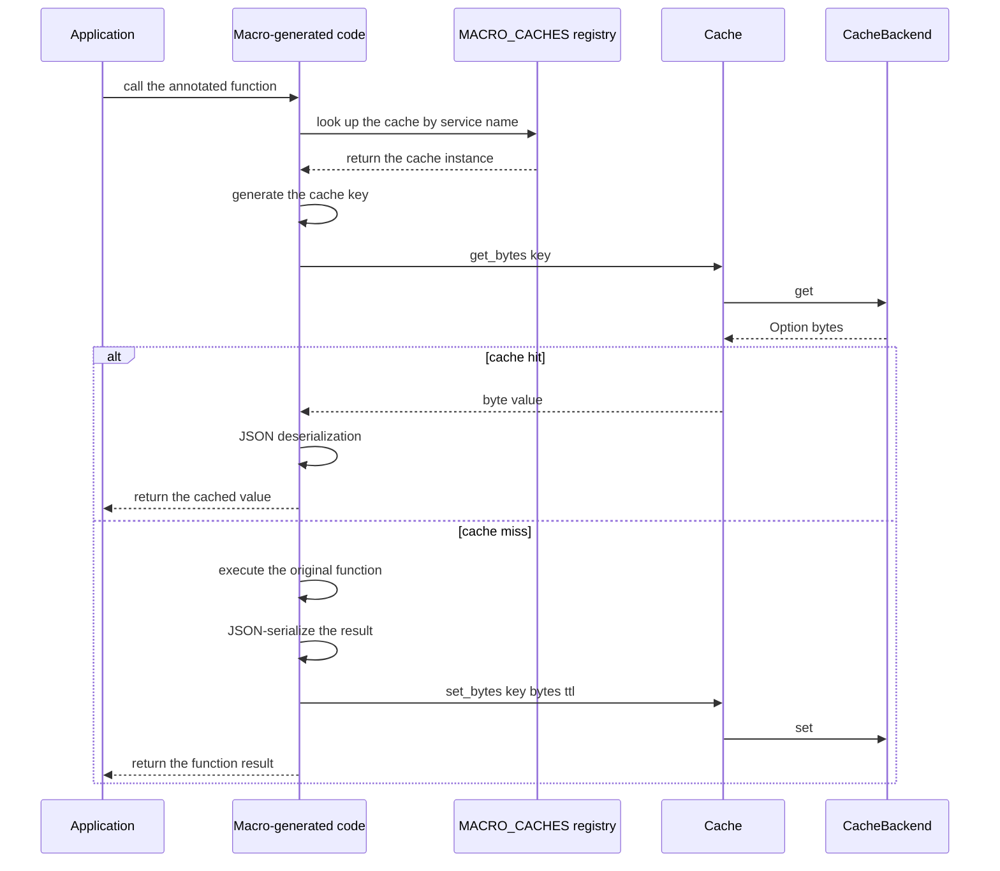
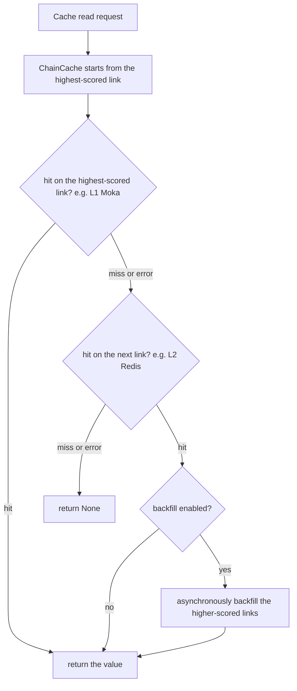
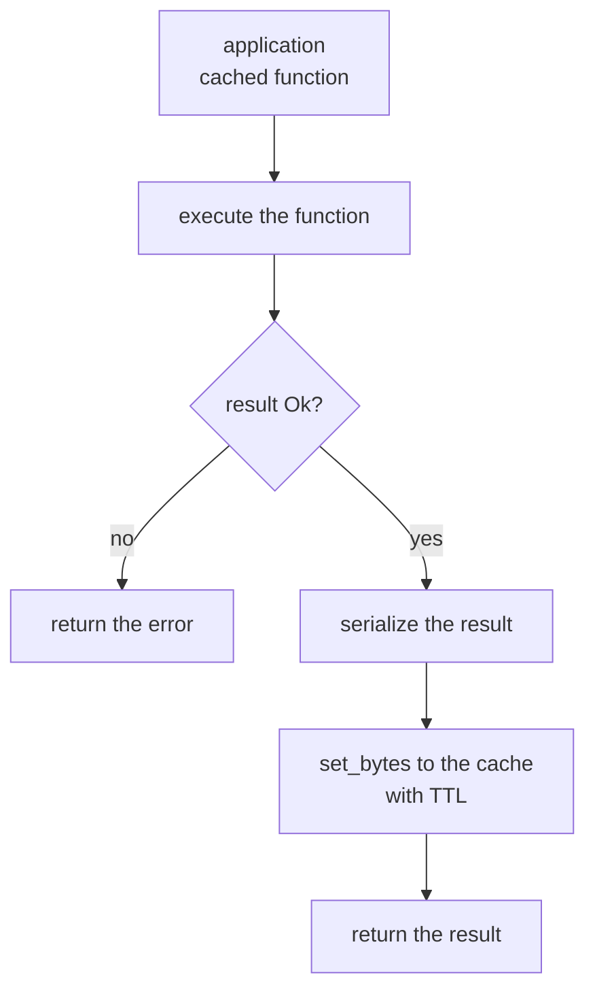
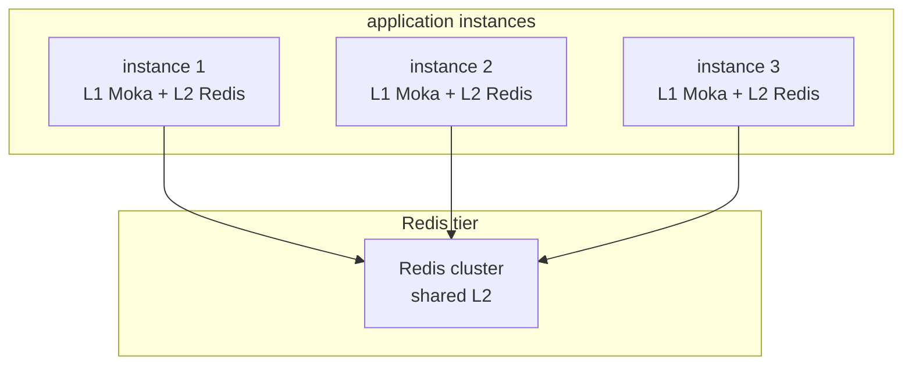
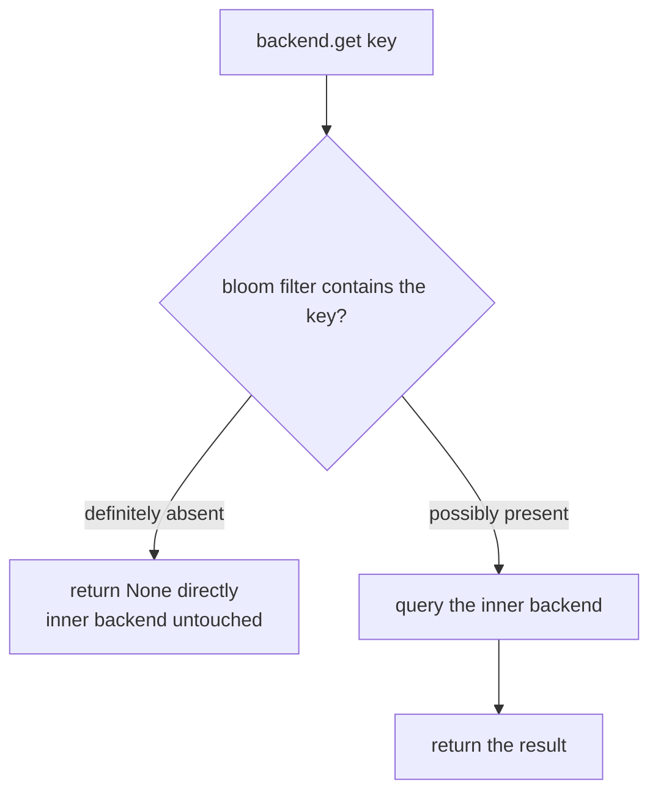

# 🏗️ Oxcache Architecture Documentation

This document describes the architecture, design decisions and technical details of the Oxcache library (`0.5.x` release line).

## 📋 Table of Contents

<details open>
<summary>📑 Table of Contents</summary>

- [🧭 Overview](#-overview)
- [🧱 Overall Architecture](#-overall-architecture)
- [🧩 Components](#-components)
  - [1. Internal Cache Registry](#1-internal-cache-registry)
  - [2. Cache Interface](#2-cache-interface)
  - [3. Backend Layer](#3-backend-layer)
  - [4. Feature Modules](#4-feature-modules)
  - [5. Infrastructure Modules](#5-infrastructure-modules)
  - [6. Security Module](#6-security-module)
  - [7. Key Generator](#7-key-generator)
  - [8. Event Module](#8-event-module)
  - [9. Config and Registry Modules](#9-config-and-registry-modules)
- [🔀 Data Flow](#-data-flow)
- [📐 Consistency Model](#-consistency-model)
- [🧯 Failure Handling](#-failure-handling)
- [⚡ Performance Optimization](#-performance-optimization)
- [🔒 Security](#-security)
- [📈 Scalability](#-scalability)
- [🎨 Feature Flags](#-feature-flags)
- [🔮 Future Enhancements](#-future-enhancements)
- [📚 References](#-references)
- [🌸 Bloom Filter & Penetration Guard](#-bloom-filter--penetration-guard)
- [⏱️ TTL Behavior Reference](#-ttl-behavior-reference)

</details>

## 🧭 Overview

Oxcache is a multi-tier caching system designed for high-performance, production-ready applications. It integrates:

- **L1 cache**: in-memory caching using Moka (LRU/TinyLFU eviction) or DashMap
- **L2 cache**: distributed caching using Redis (Standalone/Sentinel/Cluster), Valkey, Dragonfly or Aerospike
- **ChainCache**: a multi-backend cache chain ordered by score, with backfill and race reads
- **Sync API**: a synchronous mirror of the async API (`get_sync` / `set_sync` / …) for non-async call sites
- **Bloom filter**: an optional decorator that short-circuits negative queries before they reach the inner backend
- **Per-entry TTL**: all backends uniformly support `ttl` / `expire` operations
- **Penetration & stampede guards**: single-flight dedup (64 shards), null sentinel, TTL jitter, bloom negative-query short-circuit
- **Cross-instance invalidation**: the `invalidation` feature broadcasts invalidation events over Redis Pub/Sub, with a keyspace-notification second channel
- **Versioned CAS**: the `versioning` feature provides both in-memory and Redis WATCH/MULTI/EXEC `compare_and_swap` implementations
- **Auto-degradation**: the `degradation` feature's three-state machine (Active/Degraded/HalfOpen) degrades to L1-only on failure and recovers automatically via probing

> **Note**: the WAL (Write-Ahead-Log) recovery layer referenced in historical versions of this document does not exist in the current codebase; durability is delegated to the Redis backend itself; the cross-instance invalidation layer landed as the `invalidation` feature in 0.5.0-rc.4.

### Design Goals

1. **Performance**: L1 latency 50-100ns, L2 latency 1-5ms (P99, environment-dependent)
2. **Reliability**: the backend trait hierarchy lets callers degrade gracefully when L2 is unreachable
3. **Usability**: zero-boilerplate integration via the `#[cached]` macro
4. **Observability**: metrics (`CacheStats`, Prometheus/JSON export), `telemetry` tracing, health checks
5. **Security**: input validation for Redis keys / Lua scripts / SCAN patterns, sensitive-data redaction

## 🧱 Overall Architecture

Oxcache follows a layered design of "unified interface + pluggable backends". Applications face a single type-safe entry point, `Cache<K, V>`, with serialization (`infra::serialization`) and metrics (`infra::metrics`) as cross-cutting layers behind it. All reads and writes ultimately land on backends implementing the three traits `CacheReader` / `CacheWriter` / `CacheConnector`, which a blanket impl composes into `CacheBackend`. The `#[cached]` macro is provided by the separate `oxcache_macros` crate and, via the `internal::MACRO_CACHES` registry, plugs function calls into the same cache path.



Modules such as `batch` (buffered writes), `integrations::kit` (lifecycle integration), `i18n`, `config`, `traits` and `testing` mount behind feature gates.

## 🧩 Components

### 1. Internal Cache Registry

**Location**: `src/internal.rs`

**Responsibility**: central registry of cache instances, used by the `#[cached]` macro.

**Data structure**:

```rust
type MacroCacheMap = Mutex<HashMap<String, Arc<Cache<String, Vec<u8>>>>>;
static MACRO_CACHES: once_cell::sync::OnceCell<MacroCacheMap> = ...;
```

The registry stores **concrete `Cache<String, Vec<u8>>` Arc handles** (not trait objects), keyed by service name. It uses `Mutex<HashMap<…>>` rather than `DashMap`.

**Public internal functions** (only two):

- `__internal_register_cache(name, cache: Arc<Cache<String, Vec<u8>>>)` — registers/overwrites a service's cache (synchronous; a poisoned mutex makes it a no-op)
- `__internal_get_cache(name) -> Option<Arc<Cache<String, Vec<u8>>>>` — fetches a cache by service name (synchronous)

Both are re-exported from `oxcache::internal`; `oxcache::__internal_get_cache` is re-exported at the crate root for the macro-generated code.

**Thread safety**: the mutex is held only while the map is mutated/looked up (no await while holding the lock).

**Usage pattern**:

```rust
use oxcache::Cache;

// Build the cache instance
let cache: Cache<String, Vec<u8>> = Cache::builder().build().await?;

// Option 1: register via the internal module (for the #[cached] macro)
oxcache::internal::__internal_register_cache("my_service", Arc::new(cache.clone()));

// Option 2: the convenience method on Cache
cache.register_for_macro("my_service").await?;

// Macro-generated code fetches the cache from the registry:
#[cached(service = "my_service", ttl = 300)]
async fn get_user(id: u64) -> User { /* ... */ }
```

### 2. Cache Interface

**Location**: `src/cache/`

**Responsibility**: the unified type-safe cache interface.

**Module structure**:

- `cache/mod.rs` — module root and re-exports
- `cache/builder/` — `CacheBuilder` implementation
- `cache/api/` — cache operation implementations (`basic_ops`, `batch_ops`, `bytes_ops`, `macros`, etc.)
- `cache/chain.rs` + `cache/chain/` — `ChainCache`, `ChainLink`, `ChainCacheBuilder`
- `cache/interface.rs` — the `UnifiedCache` trait
- `cache/typed_namespace.rs` — `TypedNamespace` typed namespace isolation

**Key types**:

- `Cache<K, V>`: the main cache type with generic key (`K: CacheKey`) and value (`V: Serialize + DeserializeOwned`)
- `CacheBuilder<K, V>`: builder for creating configured cache instances
- `ChainCache` / `ChainLink` / `ChainCacheBuilder`: multi-tier cache chain (ordered by score)
- `L1Builder` / `L2Builder` / `ChainBuilder`: tiered builder API (coexists with `CacheBuilder`/`ChainCacheBuilder`)

For `Cache<K, V>`'s constructors (`builder` / `new` / `memory` / `redis` / `with_dependencies`), all `CacheBuilder` methods, and the note that "`CacheBuilder` does not expose `.redis(...)` / `.tiered(...)` etc.; compose multiple backends with `ChainCache` + `.backend_arc(...)`", see the [API Reference](API_REFERENCE.md#-cachebuilder). Key point: `sync_mode(true)` supports three configurations — the default Moka backend (natively sync, runtime-independent), natively-sync backends injected via `sync_backend_arc(Arc<dyn SyncCacheBackend>)` (sync API connects directly, async API presented through the `SyncBackendAdapter` facade), and `backend_arc(Arc<dyn CacheBackend>)` (the concrete type's sync implementation is erased; the sync API is bridged through the generic `AsyncToSyncBridge`: `block_in_place` + `block_on`, requiring a multi-thread runtime at call time, otherwise each call explicitly returns `Err(NotSupported)`).

For the signatures of the key async methods (`get` / `set` / `set_with_ttl` / `get_by_str` / `set_by_str` / `delete` / `exists` / `clear` / `get_or` / `ttl` / `expire` / `get_bytes` / `set_bytes` / lifecycle & stats / `register_for_macro`) and the sync methods (`get_sync` / `set_sync` / `set_with_ttl_sync` / `delete_sync` / `exists_sync` / `clear_sync` / `ttl_sync` / `expire_sync` / `get_or_sync`), see the [API Reference](API_REFERENCE.md#-cachek-v) and the [Sync API chapter of the API Reference](API_REFERENCE.md#-sync-api).

**Thread safety**: all operations are thread-safe through `Arc<dyn CacheBackend>` (`Option<Arc<dyn SyncCacheBackend>>` on the sync path).

**Usage pattern**:

```rust
use oxcache::Cache;
use std::time::Duration;

// 1) Simple in-memory cache (default)
let cache: Cache<String, User> = Cache::builder()
    .ttl(Duration::from_secs(3600))
    .capacity(10000)
    .build()
    .await?;

// 2) Redis cache (TLS enforced unless OXCACHE_ALLOW_INSECURE_REDIS is set)
let cache: Cache<String, User> = Cache::redis("rediss://localhost:6379").await?;

// 3) Inject any custom backend
let backend: Arc<dyn oxcache::backend::CacheBackend> = /* ... */;
let cache: Cache<String, User> = Cache::builder()
    .backend_arc(backend)
    .ttl(Duration::from_secs(3600))
    .build()
    .await?;

// 4) Sync API (the default Moka path is natively sync and runtime-independent; backend_arc + sync_mode
//    is bridged out through AsyncToSyncBridge and requires a multi_thread runtime)
let cache: Cache<String, String> = Cache::builder()
    .sync_mode(true)
    .build()
    .await?;
cache.set_sync(&"k".to_string(), &"v".to_string())?;
let v = cache.get_sync(&"k".to_string())?;

// Register for use by the #[cached] macro
cache.register_for_macro("my_service").await?;
```

### 3. Backend Layer

**Location**: `src/backend/`

**Responsibility**: pluggable cache backend implementations following an ISP-compliant trait hierarchy.

**Module structure**:

- `backend/mod.rs` — module root and re-exports
- `backend/interface/` — `CacheReader` / `CacheWriter` / `CacheConnector` / `CacheBackend` and their sync mirrors; `AtomicCacheWriter` / `SyncAtomicCacheWriter` for atomic operations; `CachePatternOps` for pattern-level counting / deletion
- `backend/memory/` — in-memory backend implementations (Moka, DashMap) and the Redis/Valkey client
- `backend/dragonfly/` — Dragonfly backend (wrapped over the Redis protocol)
- `backend/aerospike/` — Aerospike backend (independent protocol, feature-gated)
- `backend/score.rs` — `BackendScore` / `Scores` constants used by `ChainCache`
- `backend/config_validation.rs` — Redis/Valkey URL / Sentinel configuration validation
- `backend/factory.rs` — `BackendFactory` / `BackendRegistry` / `BackendSpec` backend factory registry

**Backend types** (re-exported at `oxcache::backend::*`, some at the crate root):

| Type | Path | Feature | Description |
|------|------|---------|-------------|
| `MokaMemoryBackend` | `oxcache::backend::MokaMemoryBackend` | `memory` | L1 cache, Moka (LRU/TinyLFU) |
| `DashMapMemoryBackend` | `oxcache::backend::DashMapMemoryBackend` | `memory` | Pure in-memory concurrent cache, FIFO O(1) eviction |
| `RedisBackend` | `oxcache::backend::RedisBackend` | `redis` | L2 distributed cache (Redis/Valkey) |
| `RedisBackendBuilder` | `oxcache::backend::RedisBackendBuilder` | `redis` | Redis/Valkey builder (modes, pool, TLS) |
| `DragonflyBackend` | `oxcache::backend::DragonflyBackend` | `dragonfly` | Dragonfly cache (Redis protocol compatible) |
| `AerospikeBackend` | `oxcache::backend::AerospikeBackend` | `aerospike` | Aerospike persistent KV store |
| `ChainCache` | `oxcache::cache::chain::ChainCache` | — | Multi-backend cache chain ordered by score |
| `BloomFilterBackend` | `oxcache::features::bloom_filter::BloomFilterBackend` | `bloom` | Negative-query filtering decorator |
| `RedbDiskBackend` | `oxcache::backend::disk::RedbDiskBackend` | `disk` | L3 disk persistence (embedded redb, lazy expiry + `max_entries` sweep) |

**Async trait hierarchy** (`backend/interface/`):

```rust
#[async_trait]
pub trait CacheReader: Send + Sync + 'static {
    async fn get(&self, key: &str) -> OxCacheResult<Option<Vec<u8>>>;
    async fn exists(&self, key: &str) -> OxCacheResult<bool>;
    async fn ttl(&self, key: &str) -> OxCacheResult<Option<Duration>>;
    async fn len(&self) -> OxCacheResult<u64>;
    async fn is_empty(&self) -> OxCacheResult<bool> { /* default implementation */ }
    async fn capacity(&self) -> OxCacheResult<u64>;
    async fn stats(&self) -> OxCacheResult<HashMap<String, String>>;
    async fn get_many(&self, keys: &[String]) -> OxCacheResult<Vec<Option<Vec<u8>>>> { /* default */ }
    async fn keys(&self, pattern: &str) -> OxCacheResult<Vec<String>> { /* default: empty Vec */ }
}

/// Batch-write item type: `(Arc<str> key, Arc<Vec<u8>> value, Option<Duration> ttl)`
pub type CacheSetItem = (Arc<str>, Arc<Vec<u8>>, Option<Duration>);

#[async_trait]
pub trait CacheWriter: Send + Sync + 'static {
    async fn set(&self, key: Arc<str>, value: Arc<Vec<u8>>, ttl: Option<Duration>) -> OxCacheResult<()>;
    async fn delete(&self, key: &str) -> OxCacheResult<()>;
    async fn clear(&self) -> OxCacheResult<()>;
    async fn expire(&self, key: &str, ttl: Duration) -> OxCacheResult<bool>;
    async fn set_many(&self, items: &[CacheSetItem]) -> OxCacheResult<()> { /* default */ }
    async fn delete_many(&self, keys: &[String]) -> OxCacheResult<()> { /* default */ }
}

#[async_trait]
pub trait CacheConnector: Send + Sync + 'static {
    async fn health_check(&self) -> OxCacheResult<()>;
    async fn shutdown(&self);
    fn backend_kind(&self) -> BackendKind;
    #[cfg(feature = "lua")]
    fn as_lua_executor(&self) -> Option<&dyn LuaExecutor> { None }
    fn as_atomic_writer(&self) -> Option<&dyn AtomicCacheWriter> { None }
    fn as_pattern_ops(&self) -> Option<&dyn CachePatternOps> { None }
}

#[async_trait]
pub trait CacheBackend: CacheReader + CacheWriter + CacheConnector + 'static {
    async fn delete_by_pattern(&self, pattern: &str) -> OxCacheResult<u64>;
    async fn count_by_pattern(&self, pattern: &str) -> OxCacheResult<u64>;
}
// Blanket impl: any T satisfying the three supertraits automatically becomes a CacheBackend.
```

**CachePatternOps** (pattern-level operation capability, an independent trait): count / delete keys matching a glob pattern.

```rust
#[async_trait]
pub trait CachePatternOps: Send + Sync + 'static {
    async fn pattern_count(&self, pattern: &str) -> OxCacheResult<u64>;
    async fn pattern_delete(&self, pattern: &str) -> OxCacheResult<u64>;
}
```

A single key enumeration (`CacheReader::keys`) has a count cap (`MAX_KEYS_RETURN`): namespace invalidation
(a `prefix*` matching tens of thousands of keys) necessarily hits that cap at the enumeration level, and the
enumerate-then-delete path would fail wholesale (not deleting a single key). Backends expose the pattern-level
capability via `CacheConnector::as_pattern_ops()`, and `CacheBackend::delete_by_pattern` / `count_by_pattern`
take the native path through it (unconstrained by the enumeration cap); backends without the capability fall
back to "enumerate + delete one by one".

The two traits' method names are deliberately different (`pattern_count` / `pattern_delete` versus
`count_by_pattern` / `delete_by_pattern`): a backend type is also a `CacheBackend` via the blanket impl, and
same-named methods would make method-call syntax on the concrete type report E0034 (multiple candidates apply
at once). The unified public entry points are `count_by_pattern` / `delete_by_pattern` on `CacheBackend`.

**Sync trait hierarchy** (mirrors the async version, without `async`/`#[async_trait]`):

```rust
pub trait SyncCacheReader: Send + Sync + 'static { /* sync fn */ }
pub trait SyncCacheWriter: Send + Sync + 'static { /* sync fn */ }
pub trait SyncCacheConnector: Send + Sync + 'static { /* sync fn */ }
pub trait SyncCacheBackend: SyncCacheReader + SyncCacheWriter + SyncCacheConnector + 'static {}
```

Backends opt into the sync API by additionally implementing the sync traits. `Cache<K, V>::get_sync` dispatches through `Arc<dyn SyncCacheBackend>`. **The async and sync hierarchies are intentionally separated** so a backend can support only one of them, and so the async trait object stays object-safe (no `block_in_place` on the async hot path).

**AtomicCacheWriter** (an independent trait, not a supertrait of `CacheWriter`):

```rust
#[async_trait]
pub trait AtomicCacheWriter: Send + Sync + 'static {
    async fn incr(&self, key: &str, delta: i64, ttl: Option<Duration>) -> OxCacheResult<i64>;
    async fn compare_and_swap(&self, key: &str, expected: Option<&[u8]>, new: Vec<u8>, ttl: Option<Duration>) -> OxCacheResult<bool>;
    async fn set_if_absent(&self, key: &str, value: Vec<u8>, ttl: Option<Duration>) -> OxCacheResult<bool>;
}

pub trait SyncAtomicCacheWriter: Send + Sync + 'static { /* sync mirror */ }
```

Backends expose the atomic capability through `CacheConnector::as_atomic_writer()`. `Cache<K,V>::incr()` / `compare_and_swap()` / `set_if_absent()` delegate through this runtime-discovery method; when a backend lacks atomic support the calls return `Err(NotSupported)`. The `versioning` feature additionally provides `MemoryVersionedCache` / `RedisVersionedCache` (WATCH/MULTI/EXEC) with version envelopes.

**The `BackendKind` enum** (`Moka | DashMap | Redis | Valkey | Dragonfly | Aerospike | Chain | Mock | Disk | Unknown`) is returned by `backend_kind()`, identifying the backend at runtime without `as_any()`.

**ChainCache read path**:

```
1. Walk the ChainLinks from the highest score (L1) down to the lowest (L2)
2. Hit → return the value
3. Miss (None or Err) → log a warning and continue with the next link
   (an L1 read failure degrades gracefully instead of failing the request)
4. After a hit on a non-top link, if backfill is enabled,
   sequentially await writes to the higher-scored (closer to L1) links
   (the read path waits for the backfill to finish before returning; a single-link failure only warns and does not propagate)
```

With `enable_race_read()` (opt-in), the read path instead queries **all** backends **concurrently** (`JoinSet`), and once every query has finished the highest-scored hit (lowest link index) is returned;
on non-top hits the backfill is still awaited sequentially,
and a read errors only when all backends fail.

Read behavior is now enumerated as `ChainReadStrategy` (`ChainCacheBuilder::read_strategy()`):
`Sequential` (default, equivalent to race read off), `Race` (equivalent to `enable_race_read()`,
taking the highest-scored hit), `ParallelFreshest` (concurrent full read, then pick the freshest by remaining TTL, None lowest
priority, ties resolved by highest score; introduced by absorb-hitbox-features). `enable_race_read()` /
`disable_race_read()` are kept as compatibility aliases.

**ChainCache write path**:

```
1. Write to all links concurrently (JoinSet; no threshold filtering, persistent backends included)
2. A single link failure is only logged and tolerated; only when all backends fail
   does the write return an error
3. No WAL (durability is delegated to the Redis backend itself)
```

**ChainCache health check**: every link is pinged concurrently, 5-second timeout per backend; if any link fails (including timeouts) `health_check()` returns an error, and `Ok` is returned only when all links are healthy.

### 4. Feature Modules

**Location**: `src/features/`

**Responsibility**: optional capabilities and runtime feature information.

**Key items**:

- `features::bloom_filter::BloomFilter` — probabilistic data structure (`new(capacity, fpr)`, `insert`, `contains`, `clear`, `len`, `is_empty`)
- `features::bloom_filter::BloomFilterBackend` — decorator wrapping any `CacheBackend`; on `get`, if the key is not in the bloom filter it returns `Ok(None)` immediately
- `features::dist_lock` — Redis distributed lock (watchdog renewal, reentrant); `red-lock` provides the `RedLock` multi-node majority lock with fencing tokens
- `features::encryption` — the `EncryptedBackend` value-level XChaCha20-Poly1305 encryption decorator
- `features::invalidation` — cross-instance invalidation bus (Redis Pub/Sub broadcast + keyspace notifications)
- `features::degradation` — the `DegradableBackend` three-state auto-degradation decorator; `DegradationController::snapshot()` read-only snapshot + `DegradationTracing` (telemetry) state-transition observability bridge; together with the backend built-in circuit breaker (RedisBackend default 5 failures/30s) it forms two-layer semantics, with independently timed recovery windows
- `features::compression` — the `CompressingBackend` adaptive zstd compression decorator
- `features::stale` — the `StaleWhileRevalidateBackend` SWR three-state expiry decorator (Actual/Stale/Expired dual-timestamp envelope) + the three `StalePolicy` strategies (Return / Revalidate / OffloadRevalidate); wired via `CacheBuilder::stale_ttl()` / `stale_policy()`; background refresh via `Cache::get_or_refresh()` (`offload` feature)
- `features::offload` — the `OffloadManager` background task subsystem (per-key dedup, semaphore concurrency cap, Cancel/Warn timeouts)
- `features::adaptive_ttl` — the `AdaptiveTtlBackend` adaptive-TTL decorator (hot extension / cold shortening, all thresholds explicit constants, `adaptive-ttl` feature off by default); wired via `CacheBuilder::adaptive_ttl()`
- `features::audit` — `AuditEventPublisher` structured audit event stream
- `features::versioning` — versioned CAS implementations
- `features::confers_config` — confers config-driven build (`OxcacheConfig` + `ConfigBus` hot reload)

### 5. Infrastructure Modules

**Location**: `src/infra/`

**Responsibility**: metrics, serialization and key validation utilities.

**Submodules**:

- `infra/metrics/backend.rs` — `MetricsCollector`, `LatencyHistogram`, `OperationCounter`, `FullMetrics`
- `infra/metrics/snapshot.rs` — `CacheStats`
- `infra/metrics/export.rs` — `export_json_format`, `export_prometheus_format`, `get_enhanced_stats`
- `infra/metrics/unified.rs` — `UnifiedMetrics`, atomic counters, histogram data
- `infra/serialization/` — JSON serializer (`JsonSerializer`), `UnifiedSerializer` and binary formats (`SerializationFormat`: Json/Bincode/Postcard)
- `infra::validate_cache_key(key)` — key validation convenience method

**Crate-root re-exports** (when the `metrics` feature is enabled):

```rust
pub use infra::{export_json_format, export_prometheus_format, export_prometheus_standard, get_enhanced_stats, CacheStats};
```

**Important**: `MetricsCollector` is **not** re-exported at the crate root. It lives at `oxcache::infra::metrics::backend::MetricsCollector::new() -> OxCacheResult<Self>`. The abstraction for metric injection is the `MetricsRecorder` port (re-exported at the crate root, with the `NoOpMetricsRecorder` default implementation).

**Serialization**: JSON by default (the `serialization` feature pulls `serde` + `serde_json`); the `serde-bincode` / `postcard` features enable the corresponding binary formats, switched via `CacheBuilder::serialization_format()`, and formats must not be mixed under the same key prefix. Serialization is implemented in `infra/serialization/` (`json.rs`, `binary.rs`, `unified.rs`, `utils.rs`, `depth_limited.rs`):

- **`JsonSerializer`** — serializer on the async/sync backend side (values are `Vec<u8>`); `with_compression()` enables flate2 gzip output.
- **`UnifiedSerializer`** — value-level codec (`serialize<T>` / `deserialize<T>` / `estimate_size`), used by `Cache<K, V>` and the `#[cached]` macro.
- **`depth_limited.rs`** — `deserialize_safe` protects against deeply nested JSON DoS: it disables the `serde_json` recursion limit (`unbounded_depth` feature) and wraps the stream with `serde_stacker` into stack-based recursion, with depth explicitly controlled by `MAX_JSON_DEPTH` (64 levels); the text deserialization path is further hardened by a `MAX_JSON_SIZE` (5 MB) size cap and a 64 MiB decompressed-output cap.

No base64 round trip on the wire: values travel as raw bytes (optionally compressed).

### 6. Security Module

**Location**: `src/security/`

**Responsibility**: input validation and sensitive-data redaction. The module itself is `pub(crate)` — callers must use the **crate-root re-exports**.

**Submodules**:

- `security/validation.rs` - Redis key, Lua script and SCAN pattern validation
- `security/redaction.rs` - sensitive-data redaction (the `Redacted` wrapper)
- `security/log.rs` - secure logging utilities
- `security/security_impl.rs` - `validate_redis_key` / `validate_lua_script` / `validate_scan_pattern` implementations and pattern scan tables

**Crate-root re-exports** (when the `redis` or `full` feature is enabled):

```rust
pub use crate::security::{
    clamp_scan_count,
    log::{log_cache_key, sanitize_message},
    redaction::{redact_cache_key, redact_connection_string, redact_field, redact_value, Redacted},
    validate_lua_script, validate_redis_key, validate_scan_pattern,
};
```

> **Import path note**: `oxcache::security::*` is an **invalid** path (the module is `pub(crate)`). Use `oxcache::validate_redis_key(...)` etc. directly. The function name is `validate_redis_key` (not `validate_key`). For the full security design, see the security document.

### 7. Key Generator

**Location**: `src/utils/`

**Responsibility**: cache key generation and management.

**Key types**:

- `KeyGenerator`: utility for generating cache keys with namespaces and prefixes (re-exported at `oxcache::KeyGenerator`)

**Key methods**:

- `new()`: creates a default key generator
- `with_namespace(ns)`: sets a namespace for key isolation
- `with_prefix_str(prefix)`: sets a prefix for key organization
- `generate(template, params)`: generates a key from a template
- `generate_full(template, params)`: generates a key with namespace and prefix
- `validate_key(key)`: validates the key format

**Usage pattern**:

```rust
use oxcache::KeyGenerator;

let generator = KeyGenerator::new()
    .with_namespace("myapp")
    .with_prefix_str("cache:");

let key = generator.generate_full("user:{id}", &[("id", "123")]);
// Result: "myapp:cache:user:123"
// Note: the prefix is concatenated as-is (no separator), so bring your own trailing colon
```

### 8. Event Module

**Location**: `src/core/events.rs`

**Responsibility**: cache event system for monitoring and hooks.

**Key types** (re-exported at the crate root):

- `CacheEventType`: event type enum (`Hit`, `Miss`, `Set`, `Delete`, `Expire`, `Clear`, `Get`, `BatchStart`, `BatchEnd`, `Error`, `Connect`, `Disconnect`, `Custom(String)`)
- `CacheEvent`: event data structure (built with the builder pattern)
- `EventPublisher`: event publishing trait (provides `NoopPublisher` for tests)

**`CacheEvent` API** (builder pattern):

```rust
let event = CacheEvent::new(CacheEventType::Hit)
    .with_key("user:123")
    .with_latency(15)
    .with_metadata("source", "l1");
```

Fields: `event_type`, `key: Option<String>`, `timestamp: u64` (milliseconds), `latency_ms: Option<u64>`, `error: Option<String>`, `metadata: Vec<(String, String)>`.

### 9. Config and Registry Modules

**Location**: `src/config/`, `src/registry.rs`, `src/backend/factory.rs`

- **`config/`**: a public module (`pub mod config` unconditionally compiled in the current `0.5.x` release line, part of the public surface), carrying distributed parameter types (`DistributedConfig`: retry policy, circuit-breaker thresholds, health-check interval) and config entries such as `CacheConfig`; programmatic building is still recommended via `CacheBuilder` and `RedisBackendBuilder`; the `config-confers` feature additionally provides the confers-loaded `OxcacheConfig` (capacity/TTL/circuit params) and `ConfigBus` watch hot reload.
- **`registry.rs`**: global cache registry (`init` / `register` / `get` / `remove` / `clear`) for explicitly managing multiple named cache instances.
- **`backend::factory`**: the `BackendRegistry` backend factory registry, registering/building backends by name (built-in moka/dashmap/memory, redis behind a feature gate), with a serde-friendly `BackendSpec`, for dynamic backend selection by kit and friends.

## 🔀 Data Flow

### #[cached] Macro Execution Path

The `#[cached]` macro achieves zero-boilerplate caching by handling cache lookup, storage and serialization automatically. The valid macro parameters are: `service`, `ttl`, `key`, `key_prefix`, `sync`, `skip_cache_write`, `single_flight`, `strict`, `condition`, `skip`, `cache_none` (there are no `key_generator` or `cache_type` parameters).



**Macro-generated code structure**:

```rust
#[cached(service = "my_service", ttl = 300)]
async fn get_user(id: u64) -> OxCacheResult<User> {
    // ... original function body ...
}
```

Roughly expands to:

```rust
async fn get_user(id: u64) -> OxCacheResult<User> {
    let cache_key = format!("my_service:get_user:{:?}", id);

    // Fetch the cache from the registry (synchronous lookup)
    let client = match oxcache::__internal_get_cache("my_service") {
        Some(c) => c,
        None => return { /* original code */ }.await,
    };

    // Try a cache hit (JSON-deserialize into User)
    if let Ok(Some(bytes)) = client.get_bytes(&cache_key).await {
        if let Ok(val) = serde_json::from_slice::<User>(&bytes) {
            return Ok(val);
        }
    }

    // Execute the original function
    let result = { /* original code */ }.await;

    // Cache the result on success
    if let Ok(ref val) = result {
        if let Ok(bytes) = serde_json::to_vec(val) {
            let _ = client.set_bytes(&cache_key, bytes, Some(Duration::from_secs(300))).await;
        }
    }

    result
}
```

Unregistered services silently pass through and execute the original function by default; `strict` mode panics instead; when the `condition` predicate returns false, the cache is bypassed.

### ChainCache Read Path



For the step-by-step semantics of reads, writes and backfill (including `enable_race_read()` race reads), see [the ChainCache paths in the backend layer](#3-backend-layer).

### Write Operation (with the #[cached] macro)



> **Note**: `#[cached]` calls `set_bytes` on the registered `Cache<String, Vec<u8>>`, which dispatches to the attached backend (memory, Redis, ChainCache or BloomFilterBackend). If the backend is a `ChainCache`, the chain handles the L1+L2 writes internally according to score/backfill policy.

## 📐 Consistency Model

### Single-Instance Consistency

Within a single `Cache<K, V>` instance, the configured backend determines consistency:

- **Moka / DashMap only**: in-process strong consistency. No cross-instance coordination.
- **Redis only**: strong consistency through Redis's single-threaded command execution.
- **ChainCache (Moka + Redis)**: in-process read-after-write consistency. The L1 cache is updated synchronously; the L2 (Redis) write completes before `set` returns. With backfill enabled, an L2 hit asynchronously fills L1.

### Cross-Instance Consistency

Under the default configuration, oxcache does **not** automatically invalidate L1 across instances; multi-instance consistency is the application's responsibility. Two paths:

**Built-in path (the `invalidation` feature)**:

- Redis Pub/Sub broadcasts invalidation events (key / namespace granularity); each instance listens in the background and invalidates its local L1; messages carry an `instance_id`, exempting the writing instance from self-invalidation
- The `KeyspaceNotificationListener` keyspace-notification second channel projects external `DEL`/`EXPIRED` into local invalidations (requires Redis `notify-keyspace-events "Egx"`)
- The `InvalidatingBackend` write-path decorator plugs in transparently

**Application-managed path** (when the feature is not enabled):

- Use Redis as the single source of truth (skip L1, or accept briefly stale L1 data)
- Use a short L1 TTL to bound staleness
- Invalidate externally in the application (e.g. Redis keyspace notifications, application-level Pub/Sub) and call `cache.delete(key)` on every instance

For read-modify-write races, the `versioning` feature provides `compare_and_swap(key, expect_version, new_value)` (in-memory implementation + Redis WATCH/MULTI/EXEC implementation).

### Single Flight (cache stampede protection)

Both `get_or` (async) and `get_or_sync` (sync) implement single flight: when several concurrent calls miss the same key, only the first caller (the "leader") executes the fallback; followers block on `tokio::sync::watch` (async) or `std::sync::Condvar` (sync) until the leader writes the result. A panic-safety guard ensures followers are released even if the leader panics.

The in-flight registry is **sharded** (64 hash buckets via `DefaultHasher`) to reduce cross-key lock contention under concurrency: `get_or_shard_index(key)` routes each key to one shard, and each shard owns a `Mutex<HashMap<String, Arc<watch::Sender<()>>>>` (async) / `Mutex<HashMap<String, SyncFlight>>` (sync).

## 🧯 Failure Handling

### Redis Failures

**Detection** (via `CacheConnector::health_check()`):

- Connection timeout / refusal
- `PING` failure
- Connection closed by the remote end

**Recovery (application-driven + optional auto-degradation)**:

1. `Cache::health_check().await` returns `Err(OxCacheError::*)` — callers can switch to a fallback code path
2. `ChainCache` keeps serving L1 hits even when the L2 link errors (a miss only propagates as `None`); L1 read errors are logged and the walk falls through to the next link; L2 write failures are logged, and writes error to the caller only when all backends fail
3. **The `degradation` feature**: `DegradableBackend` protects L2; once the failure count crosses the threshold it automatically degrades to L1-only (returning a `Degraded` error for ChainCache to fall back on), enters half-open probing after the degradation timeout, recovers automatically on successful probes and re-degrades on failures; state-change callbacks + a global degraded metric. Stacked with the backend built-in circuit breaker (e.g. RedisBackend opens by default after 5 consecutive failures, half-open after 30s), it forms two-layer semantics: the two layers time and recover independently, and the outer half-open probe may be rejected by an inner breaker still Open, forming a false recovery (the outer `recovery_timeout` should not be smaller than the inner `reset_timeout`); `snapshot()` and telemetry's `DegradationTracing` provide the observability surface
4. Applications can also wrap their own circuit breaker / retry policy around the cache

There is no WAL replay mechanism after reconnection (no WAL layer exists in the current codebase).

### Network Partitions

- Each instance keeps running with its local L1 cache
- Redis writes/reads fail and surface as `Err(OxCacheError::*)`
- After recovery there is no automatic data reconciliation; the application can issue `cache.clear()` or rely on TTL expiry; with `invalidation` enabled, post-recovery write events keep driving invalidations on every instance via Pub/Sub

### Backend Trait Errors

All backend errors travel through `OxCacheError` (see `src/error.rs`). For the full error-code table (OXCACHE_001–OXCACHE_024), see the [API Reference](API_REFERENCE.md#-error-handling). Key variants:

| Error code | Variant | Meaning |
|--------|------|------|
| OXCACHE_001 | `NotFound` | Key not found |
| OXCACHE_002 | `Connection` | Network connection failure |
| OXCACHE_003 | `Serialization` | Serialization/deserialization failure |
| OXCACHE_005 | `Degraded` | Cache is in degraded mode |
| OXCACHE_007 | `L2Error` | L2 (Redis) backend error |
| OXCACHE_009 | `NotSupported` | Operation not supported by this backend/configuration |
| OXCACHE_015 | `Timeout` | Operation timed out |
| OXCACHE_020 | `InvalidInput` | Bad key/value/config input |

## ⚡ Performance Optimization

### Optimization Techniques

1. **Moka per-entry TTL**: uses the `moka::Expiry` trait for true per-entry TTL (overriding the builder's global TTL), avoiding the overhead of separate expiry tracking.
2. **Connection reuse**: the `redis` crate's `ConnectionManager` self-manages connection reuse internally (the `pool_size` parameter of `RedisBackend::with_pool` is currently retained but not wired; behavior equals `new()`).
3. **Pipeline / batch operations**: `RedisBackend` supports `set_many` / `delete_many` / `get_many` via Redis pipeline (the default trait impls loop, but `RedisBackend` overrides them). The `batch` feature adds `BatchWriter` to buffer L2 writes (capacity/time dual-threshold flush).
4. **Lock-free L1**: Moka's concurrent cache design (TinyLFU admission, LRU eviction).
5. **Pluggable serialization**: JSON by default; the `serde-bincode` / `postcard` binary formats can significantly reduce L2 transfer size (see the [Performance Baseline](PERFORMANCE.md)). The `MAX_JSON_DEPTH` constant guards against deeply nested JSON DoS.
6. **Adaptive compression**: the `compression` feature's `CompressingBackend` triggers zstd above a threshold; reads detect by magic bytes and stay compatible with legacy gzip.
7. **Single flight**: `get_or` / `get_or_sync` deduplicate concurrent fallback executions per key, preventing cache-stampede thundering herds.
8. **Bloom filter short-circuit**: `BloomFilterBackend` returns `Ok(None)` directly when a key is not in the filter, without touching the inner backend — suited to workloads with high negative-query ratios.
9. **Hot-path borrowed-key APIs**: `get_by_str` / `set_by_str` remove extra allocations on the hot path (measured get -6.7%, set -12.7%, see the [Performance Baseline](PERFORMANCE.md)).

### Performance Tuning

```rust
use std::time::Duration;
use oxcache::Cache;

let cache: Cache<String, User> = Cache::builder()
    .capacity(10_000)              // max L1 entries
    .ttl(Duration::from_secs(600)) // default TTL
    .tti(Duration::from_secs(300)) // idle TTL (Moka)
    .build()
    .await?;

// Redis connection pool size:
let redis = oxcache::backend::RedisBackend::with_pool(
    "rediss://localhost:6379", 16,
).await?;
```

### Benchmark Results

> Test environment: M1 Pro, 16GB RAM, macOS, Redis 7.0
>
> **Note**: performance varies with hardware, network conditions and data size. Treat these as order-of-magnitude estimates.

| Operation | Throughput | Latency (P99) |
|------|--------|-------------|
| L1 read | 5-10M ops/sec | 50-100ns |
| L1 write | 2-5M ops/sec | 50-200ns |
| L2 read | 50-100K ops/sec | 1-5ms |
| L2 write (batched) | 200-500K ops/sec | 1-10ms |

Reproducible measured data (serialization sizes, compression ratios, hot-path Criterion benchmarks) lives in the [Performance Baseline](PERFORMANCE.md).

## 🔒 Security

### Threat Model

1. **Cache penetration**: an attacker requests nonexistent keys → database load
2. **Cache stampede**: a hot key expires and a large burst hits the database simultaneously
3. **DoS attacks**: high request rates overwhelm the system
4. **SQL injection**: malicious patterns inside Redis keys
5. **Lua script injection**: dangerous commands inside Lua scripts
6. **ReDoS**: malicious SCAN patterns exhausting CPU
7. **Deeply nested JSON DoS**: malicious JSON causing stack overflow during deserialization

### Defenses

The threats above are mitigated by multiple layers of defense: single flight plus the null sentinel/TTL jitter (penetration & stampede guards), `validate_redis_key` / `validate_lua_script` / `validate_scan_pattern` / `clamp_scan_count` input validation (with comment preprocessing against bypass), `Redacted` and the `redact_*` redaction family, `MAX_JSON_DEPTH` + `MAX_JSON_SIZE` (5 MB) caps + a 64 MiB decompressed-output cap + stack-based recursion, TLS enforcement, and the `encrypt` / `integrity` value protection. For the complete rules of each mechanism, see the [in-library defense overview](SECURITY.md#-in-library-defense-overview) of the security document.

> **Note**: oxcache has **no built-in rate limiting**. Rate limiting is the application's or an upstream proxy's responsibility.

### Bloom Filter Penetration Guard

The `bloom` feature's `BloomFilterBackend` short-circuits negative queries before they reach the inner backend; for the mechanism diagram, example and penetration-guard combination table, see the appendix [Bloom Filter & Penetration Guard](#-bloom-filter--penetration-guard).

### Input Validation

The `security` module (private; consumed through crate-root re-exports, see the [API Reference](API_REFERENCE.md#-security-features)) provides `validate_redis_key` / `validate_lua_script` / `validate_scan_pattern` / `clamp_scan_count`; the per-rule validation details and constants live in the security document.

### Best Practices

1. **Key design**: use stable, predictable keys (use `KeyGenerator` for namespace management)
2. **TTL strategy**: set appropriate TTLs based on data volatility; use `cache.ttl(&key)` to read the existing TTL in update workflows that preserve it
3. **Access control**: use Redis AUTH + TLS (`rediss://` URLs)
4. **Monitoring**: track `CacheStats` (hit rates, operation counters, latency histograms) via `get_enhanced_stats` / `export_prometheus_format`
5. **Sync API**: enable `sync_mode(true)` for non-async call sites. The three-environment matrix of the Moka sync bridge: on a `multi_thread` runtime the current runtime is reused via `block_in_place`; inside a current_thread runtime's async context it explicitly returns `Err(NotSupported)` (tokio forbids nested blocking drivers); outside any runtime a temporary current_thread runtime drives it as a fallback. The config path `backend=moka/dashmap` uses the dual-sided native slot (the async side is runtime-independent and the sync side connects directly, zero bridging); custom sync backends are injected via `sync_backend_arc(...)` (together with `sync_mode(true)`); the combination of `backend_arc(...)` with `sync_mode(true)` bridges the sync API through `AsyncToSyncBridge` (blocking semantics, requiring a multi-thread runtime at call time; I/O-backed backends need ≥2 workers)

## 📈 Scalability

### Horizontal Scaling



Each instance maintains its own L1 (Moka) and shares L2 (Redis). Cross-instance L1 invalidation is not automatic by default; with the `invalidation` feature enabled, invalidations are broadcast over Redis Pub/Sub (see the [Consistency Model](#-consistency-model)).

### Vertical Scaling

- Increase L1 capacity via `CacheBuilder::capacity(u64)` (more memory)
- Use faster/dedicated Redis instances
- Enable Redis persistence on the Redis side (AOF + RDB)
- The `pool_size` parameter of `RedisBackend::with_pool(url, pool_size)` is currently not wired (behavior equals `new()`); connection reuse is self-managed internally by the `redis` crate's `ConnectionManager`

### Partitioning

oxcache has no built-in partitioning configuration. Applications can implement their own partitioning by routing keys to different `Cache<K, V>` instances (each backed by a different Redis db / cluster); `TypedNamespace` (marker types + the `namespace!` macro) provides compile-time namespace isolation.

## 🎨 Feature Flags

For the tiered feature sets (the `minimal` / `redis-tier` / `full` presets) and the itemized component features, see the [Feature Requirements of the API Reference](API_REFERENCE.md#-feature-requirements) and the [Feature Flags table of the API Reference](API_REFERENCE.md#-feature-flags). Opt-in features such as `bloom` and `trait-kit` are now part of `full` (`full` is the true full set: every named capability feature; the deprecated aliases `core` / `kit` / `red-lock` / `testing` are not members), and can still be enabled alone via `features = ["bloom"]`; the exact membership of `full` is in `Cargo.toml`'s `[features]`.

**Implicit dependency policy**: `Cache<K, V>`'s serde generic bounds and `UnifiedSerializer` belong to the core unconditionally-compiled path, so from this version the `memory` / `redis` features imply `serialization` (consistent with the existing policy of the `minimal` / `disk` presets); `degradation` decorates L2 backends and `adaptive-ttl` decorates any backend, both modules depend on `crate::backend`, so they imply the `memory` baseline. Enabling these features accordingly enlarges the compiled surface (pulling in serde/serde_json etc.), with no runtime behavior change.

## 🔮 Future Enhancements

1. **Geo-distribution**: multi-region replication primitives
2. **Cache warm-up**: smart warm-up strategies (the basic form has landed; periodic/automated policies remain open)

> "Cache warm-up" basic form has landed: the `warmup` feature (off by default) provides the `WarmupLoader`
> port (business forecasts / `HotKeyTracker` snapshots / upstream analytics exports, etc., as chosen) to pull the hot-key
> set and backfill `ChainCache` asynchronously — direct-supply values reach all backends via the chained write, while key-only entries
> are promoted from lower tiers via the `iter_entries` batch read; key dedup (first occurrence wins) and the write concurrency cap
> are configurable, with results fully counted explicitly in a `WarmupReport` (including per-item failure details and the measured concurrency peak).
> See [API Reference](API_REFERENCE.md#-smart-warm-up-warmup). The loader's hot-key sources and
> refresh scheduling are orchestrated by the caller; the library does not do periodic automatic warm-up.

> "Adaptive TTL" has landed with the access-pattern measurement scheme: the `adaptive-ttl` feature (off by default)
> `AdaptiveTtlBackend` decorator extends hot keys' TTL by hit counts and shortens cold keys' TTL by idle duration;
> all thresholds are explicit constants (no black-box heuristics), wired via `CacheBuilder::adaptive_ttl()`,
> see [API Reference](API_REFERENCE.md#-adaptive-ttl-adaptive-ttl). The tracking table saturates stickily:
> once `max_tracked_keys` is reached, existing entries are not evicted and new keys are no longer tracked (until `reset_stats()`);
> capacity should be reserved for the working set's unique key cardinality.

> The original "migrate to `trait_upcasting` to lift the `sync_mode + backend_arc` mutual exclusion" was ultimately fully landed via the dual-facade
> scheme: the `sync_backend_arc` first-class entry + the `SyncBackendAdapter` facade came first (sync→async direction), and the `AsyncToSyncBridge` generic bridge followed to complete the async→sync direction
> (`sync_mode(true)` + `backend_arc` bridges the sync API through it, requiring a multi-thread
> runtime at call time; the two trait hierarchies have no supertrait relation, so the upcasting scheme itself does not apply), see
> [CacheBuilder](API_REFERENCE.md#-cachebuilder).

## 📚 References

- [Moka docs](https://github.com/moka-rs/moka)
- [Redis docs](https://redis.io/docs/)
- [TinyLFU paper](https://arxiv.org/abs/1512.00757)
- [Bloom filter](https://en.wikipedia.org/wiki/Bloom_filter)
- [ISP-compliant trait design](https://en.wikipedia.org/wiki/Interface_segregation_principle)
- [📘 API Reference](API_REFERENCE.md) / [📖 User Guide](USER_GUIDE.md) / [📊 Performance Baseline](PERFORMANCE.md)

---

## 🌸 Bloom Filter & Penetration Guard

> This section was migrated from the README architecture chapter.

The `bloom` feature (now part of `full`, and still available standalone) provides negative-query filtering. The `BloomFilterBackend` decorator wraps any backend: when the bloom filter says "definitely absent", it returns `None` immediately and the inner backend is never touched.



```rust
use oxcache::backend::MokaMemoryBackend;
use oxcache::features::bloom_filter::{BloomFilter, BloomFilterBackend};

#[tokio::main]
async fn main() -> Result<(), Box<dyn std::error::Error>> {
    // Standalone BloomFilter: capacity 10_000, false-positive rate 1%
    let bf = BloomFilter::new(10_000, 0.01);
    bf.insert("existing_key");
    assert!(bf.contains("existing_key"));   // no false negatives
    assert!(!bf.contains("missing_key"));   // possible false positives

    // Decorator: wraps any CacheBackend
    let backend = BloomFilterBackend::builder()
        .capacity(10_000)
        .false_positive_rate(0.01)
        .inner(MokaMemoryBackend::new())
        .build()?;

    backend.set(Arc::from("user:1"), Arc::new(b"Alice".to_vec()), None).await?;
    assert!(backend.get("user:1").await?.is_some());
    assert!(backend.get("user:999").await?.is_none());   // filtered by the BF, inner untouched
    Ok(())
}
```

**Semantics**: no false negatives; `set` updates both BF and inner, `delete` only updates inner (BF does not support removal), `clear` resets both, TTL passes through unchanged; when the inner backend implements `SyncCacheBackend`, so does the decorator.

**Penetration and stampede guard combinations**:

| Mechanism | Entry point | Purpose |
|-----------|-------------|---------|
| Single-flight | `get_or` / `get_or_sync` / macro `single_flight` | Concurrent misses on one key trigger a single fallback; followers wait for the result (async `watch` / sync `Condvar`, 64 shards) |
| Null sentinel | `get_or_option` + `null_cache_ttl` | Caches a sentinel for `None` results so missing keys stop hitting storage repeatedly |
| TTL jitter | builder `ttl_jitter(factor)` | Actual TTL randomized within `base * (1 ± factor)` to prevent mass simultaneous expiry |
| Bloom filtering | `BloomFilterBackend` | O(1) short-circuit for negative queries, zero requests to the inner backend |

---

## ⏱️ TTL Behavior Reference

> This section was migrated from the README architecture chapter.

All backends honor per-entry `set(key, value, Some(ttl))` uniformly. Behavior summary:

| Backend | `set(ttl=Some)` | `ttl(key)` | `expire(key, new_ttl)` | Notes |
|---------|-----------------|------------|------------------------|-------|
| **MokaMemoryBackend** | Real per-entry TTL via `moka::Expiry` | Remaining TTL | Updates + returns `true` | Global TTL (`builder.ttl(...)`) is overridden by per-entry TTL |
| **DashMapMemoryBackend** | Stores `(value, expiry Instant)`; lazy expiry on read | Remaining TTL (None if no TTL) | Updates + returns `true` | Lazy expiry — entries removed on next access; FIFO O(1) eviction of oldest entries when over capacity |
| **RedisBackend** | `SET key value PX <ms>` | `TTL key` (Redis native) | `PEXPIRE key <ms>` | Redis native TTL at millisecond precision (sub-second TTLs no longer rejected) |
| **Valkey** (via RedisBackend) | Same as Redis | Same as Redis | Same as Redis | Redis protocol compatible, uses the `ValkeyStandalone` mode |
| **DragonflyBackend** | Delegates to the inner RedisBackend | Delegates to the inner RedisBackend | Delegates to the inner RedisBackend | Redis protocol compatible, TTL behavior identical to Redis |
| **AerospikeBackend** | `write_policy_with_ttl` → `Expiration::Seconds` | `record.time_to_live()` | `touch` + new `Expiration` | Aerospike native TTL (second precision); sub-second TTLs round up |
| **RedbDiskBackend** (`disk`) | Stores a `(value, expiry epoch ms)` envelope; lazy expiry on read | Remaining TTL (None if no TTL) | Updates + returns `true` (`false` when the key is missing or already expired) | `set(ttl=None)` falls back to the backend default TTL from `with_default_ttl` (never expires if unset) |
| **ChainCache** | Passes `ttl` through to all links | First `Some(ttl)` found scanning from the highest score (keeps descending when a higher-scored link owns the key but has no TTL) | Passes through to all links | All links receive the same TTL |
| **BloomFilterBackend** | Passes `ttl` through to inner (also inserts the key into the BF) | Delegates to inner | Delegates to inner | The BF itself has no TTL concept |

**Global vs per-entry**: `builder.ttl(Duration)` sets a global TTL applied to every entry; `set(key, value, Some(ttl))` overrides it for that entry; `set(key, value, None)` uses the global TTL (or never expires if unset).
